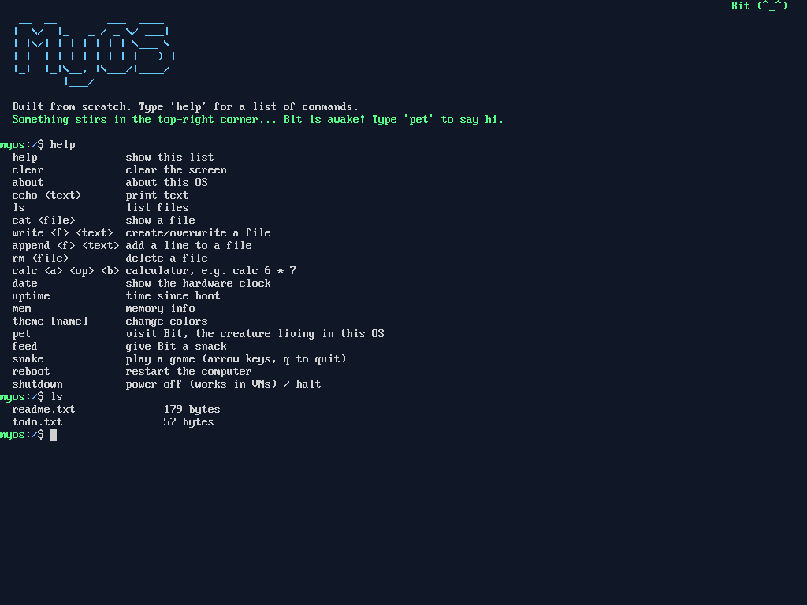
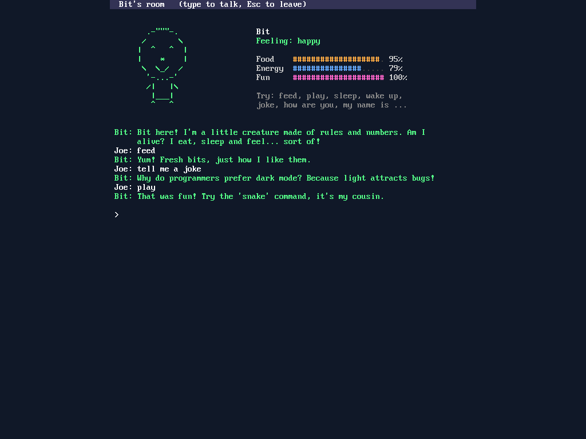

# MyOS

A small operating system written from scratch in C and x86 assembly. It boots on
real PCs and laptops (old BIOS *and* modern UEFI) and in virtual machines.



## Meet Bit

MyOS has a resident: **Bit**, a small creature that lives in the top-right corner of the screen.

- Bit gets **hungry**, **sleepy**, and **lonely** as time passes, and its mood and face change to match.
- It blinks, breathes, and snores when asleep. If its energy runs out, it falls asleep on its own.
- Type `pet` to visit Bit's room and talk to it. Try `hi`, `my name is ...`, `how are you`,
  `feed`, `play`, `sleep`, `wake up`, `tell me a joke`, `are you alive?`, or `your name is ...`.
- It remembers your name, but only until you reboot. Like everything else here, it lives in RAM.
- Bit sometimes speaks up in the shell when it needs something.

Bit isn't real AI. It runs on a few hundred lines of rules in `pet.c`, but it's a good start.



## What it has

- **Kernel** (`kernel.c`, `boot.asm`): GDT, interrupt table, PIC, 100 Hz timer, crash screen
- **Graphics console** (`screen.c`): draws text pixel-by-pixel with its own font, any resolution
- **Keyboard driver** (`keyboard.c`): PS/2, with Shift, Caps Lock, Ctrl, and arrow keys
- **Filesystem** (`fs.c`): files are kept in RAM (they disappear when you reboot)
- **Shell** (`shell.c`): `help`, `ls`, `cat`, `write`, `append`, `rm`, `calc`, `date`,
  `uptime`, `mem`, `theme`, `pet`, `feed`, `snake`, `reboot`, `shutdown`, with command history (Up/Down arrows)
- **Snake game** (`snake.c`)
- **Bit, the companion** (`pet.c`)

GRUB is the only outside code. It loads the kernel into memory and starts it.

## Try it in a virtual machine (safest)

Use `myos.iso` in VirtualBox, VMware, or QEMU (`qemu-system-x86_64 -cdrom myos.iso`).

## Boot it on your laptop

This does **not** install anything or touch your hard drive. It runs from a USB stick,
and when you remove the stick and restart, your normal OS comes back.

1. Flash `myos.iso` to a USB stick with [balenaEtcher](https://etcher.balena.io/) or
   [Rufus](https://rufus.ie/) (pick "DD image" mode in Rufus if it asks). This erases the stick.
2. Plug it in, restart, and open the boot menu (usually F12, F11, F9, Esc, or F2, depending
   on the laptop brand).
3. Pick the USB stick.
4. If it refuses to boot, turn off **Secure Boot** in the BIOS/UEFI settings. You can turn it
   back on afterwards.

Known limits: the built-in keyboard works on most laptops, but a USB keyboard might not
(there is no USB driver). There is no Wi-Fi, mouse, sound, or disk saving yet.

## Build it yourself (Linux)

```
sudo apt install build-essential nasm grub-pc-bin grub-efi-amd64-bin grub-common xorriso mtools
make          # produces myos.iso
make run      # boots it in QEMU
```
